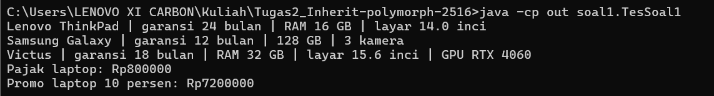
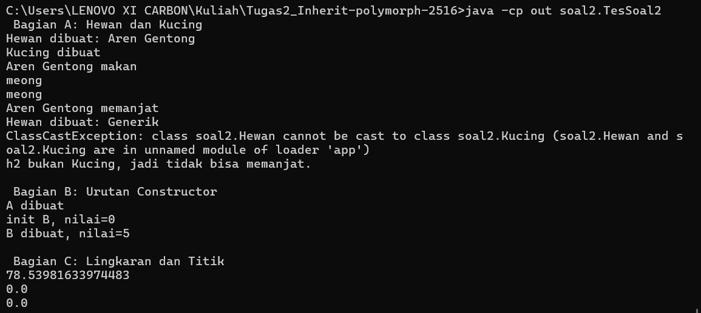
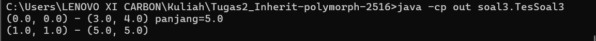
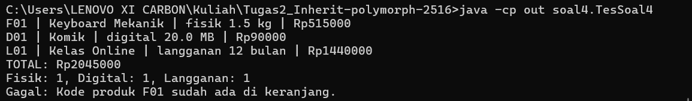

# Tugas 2 Praktikum PBO: Inheritance, Composition, dan Polimorfisme

## Identitas
* **Nama Tugas:** Tugas 2 - Inheritance, Composition, dan Polimorfisme
* **Nama Lengkap:** Rafid Khaulika
* **NPM:** 250810701100016
* **Kelas Praktikum:** Praktikum Pemrograman Berorientasi Objek Kelas A
* **Repository:** https://github.com/RafidKhaulika/Tugas2_Inherit-polymorph-2516

## Deskripsi Singkat
Tugas ini berisi empat soal latihan Java tentang inheritance, composition, dan polimorfisme. Soal 1 melatih pewarisan pada hierarki perangkat elektronik, Soal 2 melatih analisis output, error, dan polimorfisme, Soal 3 melatih composition pada titik dan garis, dan Soal 4 menggabungkan semuanya dalam mini project toko digital.

## Fitur Utama
* **Soal 1 (Perangkat Elektronik):** Pengguna dapat mencatat laptop, ponsel, dan laptop gaming lengkap dengan merek, harga, dan garansi. Laptop gaming otomatis mendapat garansi tambahan 6 bulan. Program dapat menghitung pajak 10 persen, menghitung harga promo laptop, dan menampilkan keterangan singkat tiap perangkat. Merek kosong atau harga negatif ditolak dengan pesan yang jelas.
* **Soal 2 (Analisis Konsep):** Program menunjukkan urutan pembuatan objek, perbedaan tipe variabel dan tipe objek sebenarnya, kegagalan konversi tipe yang aman ditangani, serta hasil perhitungan luas lingkaran dan titik.
* **Soal 3 (Titik dan Garis):** Pengguna dapat membuat titik dan garis, melihat panjang garis, dan mencetak garis dengan format yang mudah dibaca. Garis menyimpan salinan titiknya sendiri, jadi perubahan titik di luar tidak merusak garis.
* **Soal 4 (Toko Digital):** Pengguna dapat memasukkan produk fisik, produk digital, dan langganan ke keranjang. Harga akhir tiap produk dihitung otomatis sesuai jenisnya, lalu keranjang mencetak struk, total belanja, dan jumlah produk per jenis. Kode produk yang sama ditolak, begitu juga nama kosong atau harga negatif.

## Konsep OOP yang Diterapkan

| Nama Konsep | Lokasi Penerapan | Alasan Pemilihan Konsep |
| :--- | :--- | :--- |
| **Inheritance dan `super(...)`** | `Laptop`, `Ponsel`, `LaptopGaming` mewarisi `Perangkat` (soal1); `ProdukFisik`, `ProdukDigital`, `Langganan` mewarisi `Produk` (soal4) | Data dan perilaku yang sama cukup ditulis sekali di superclass, lalu dipakai ulang oleh subclass. |
| **Hak akses `protected`** | Atribut `harga` di `Perangkat`, dipakai di `Laptop.hitungHargaPromo()` | Subclass boleh memakai `harga` langsung, tetapi kelas lain di luar hierarki tidak. |
| **Multi level inheritance** | `LaptopGaming` extends `Laptop` extends `Perangkat` | Laptop gaming adalah jenis laptop khusus, sehingga mewarisi sifat laptop dan perangkat sekaligus. |
| **Method overriding** | `infoSingkat()` di soal1, `suara()` di soal2, `hitungHargaAkhir()` dan `deskripsi()` di soal4 | Setiap subclass punya cara sendiri untuk menghitung atau menjelaskan dirinya. |
| **Polimorfisme** | `Keranjang.cetakStruk()` dan `hitungTotal()` | Keranjang cukup memanggil method yang sama pada tiap `Produk`, dan hasilnya menyesuaikan jenis produk sebenarnya. |
| **Upcasting, downcasting, `instanceof`** | `TesSoal2` dan `Keranjang.hitungPerJenis()` | Dipakai untuk mengenali jenis objek sebenarnya dengan aman, sebelum mengubah tipe variabel. |
| **Composition (has-a)** | `Garis` punya dua `Titik` (soal3); `Keranjang` punya daftar `Produk` (soal4) | Garis bukan sebuah titik, dan keranjang bukan sebuah produk, jadi relasinya "punya", bukan "adalah". |
| **Method dan constructor overloading** | Dua constructor `Garis` dan dua constructor `Titik` | Objek bisa dibuat lewat dua cara, dan constructor kedua meneruskan ke yang pertama memakai `this(...)`. |
| **Encapsulation dan exception** | Atribut `private` dan validasi di `Perangkat` dan `Produk`; `IllegalArgumentException` dan `IllegalStateException` | Data dilindungi dan kesalahan input ditolak dengan pesan yang jelas, bukan dibiarkan masuk. |
| **Defensive copy** | Constructor, setter, dan getter `Garis` | Garis memegang salinan titiknya sendiri, jadi tidak ikut berubah saat titik asli diubah dari luar. |

## Struktur Project

```text
Tugas2_Inherit-polymorph-2516/
├── src/
│   ├── soal1/
│   │   ├── Perangkat.java
│   │   ├── Laptop.java
│   │   ├── Ponsel.java
│   │   ├── LaptopGaming.java
│   │   └── TesSoal1.java
│   ├── soal2/
│   │   ├── Hewan.java
│   │   ├── Kucing.java
│   │   ├── A.java
│   │   ├── B.java
│   │   ├── Lingkaran.java
│   │   ├── Titik.java
│   │   └── TesSoal2.java
│   ├── soal3/
│   │   ├── Titik.java
│   │   ├── Garis.java
│   │   └── TesSoal3.java
│   └── soal4/
│       ├── Produk.java
│       ├── ProdukFisik.java
│       ├── ProdukDigital.java
│       ├── Langganan.java
│       ├── Keranjang.java
│       └── TesSoal4.java
├── screenshot/
├── .gitignore
└── README.md
```

## Prasyarat
* **Versi JDK yang Dipakai:** Java Development Kit (JDK) 21. Program dikembangkan dan diuji lewat Terminal memakai JDK 21 (kompatibel juga dengan JDK 17 ke atas).
* **IDE yang Disarankan:** IntelliJ IDEA Community Edition (atau Visual Studio Code dengan Extension Pack for Java).

## Cara Menjalankan Program

### 1. Melalui Command Line (Terminal / Command Prompt)
1. Masuk ke folder project:
   ```bash
   cd Tugas2_Inherit-polymorph-2516
   ```
2. Kompilasi seluruh file Java dari keempat soal ke folder `out`:
   ```bash
   javac -d out src\soal1\*.java src\soal2\*.java src\soal3\*.java src\soal4\*.java
   ```
3. Jalankan class uji tiap soal. Nama class ditulis lengkap dengan nama package-nya:
   ```bash
   java -cp out soal1.TesSoal1
   java -cp out soal2.TesSoal2
   java -cp out soal3.TesSoal3
   java -cp out soal4.TesSoal4
   ```

### Catatan Pengumpulan
Berkas zip menyertakan folder `out` berisi file `.class` sesuai arahan asisten lab, sedangkan repository GitHub tidak menyertakannya karena dikecualikan oleh `.gitignore`.

## Contoh Output

### Soal 1
```text
Lenovo ThinkPad | garansi 24 bulan | RAM 16 GB | layar 14.0 inci
Samsung Galaxy | garansi 12 bulan | 128 GB | 3 kamera
Victus | garansi 18 bulan | RAM 32 GB | layar 15.6 inci | GPU RTX 4060
Pajak laptop: Rp800000
Promo laptop 10 persen: Rp7200000
```


### Soal 2
Pada hasil ini, `ClassCastException` sengaja ditangkap dengan `try-catch` supaya program tetap berjalan sampai Bagian B dan C.

```text
 Bagian A: Hewan dan Kucing 
Hewan dibuat: Aren Gentong
Kucing dibuat
Aren Gentong makan
meong
meong
Aren Gentong memanjat
Hewan dibuat: Generik
ClassCastException: class soal2.Hewan cannot be cast to class soal2.Kucing (soal2.Hewan and soal2.Kucing are in unnamed module of loader 'app')
h2 bukan Kucing, jadi tidak bisa memanjat.

 Bagian B: Urutan Constructor 
A dibuat
init B, nilai=0
B dibuat, nilai=5

 Bagian C: Lingkaran dan Titik 
78.53981633974483
0.0
0.0
```


### Soal 3
```text
(0.0, 0.0) - (3.0, 4.0) panjang=5.0
(1.0, 1.0) - (5.0, 5.0)
```


### Soal 4
Baris terakhir menunjukkan skenario exception yang tertangani, yaitu kode produk `F01` yang dimasukkan dua kali.

```text
F01 | Keyboard Mekanik | fisik 1.5 kg | Rp515000
D01 | Ebook Java | digital 20.0 MB | Rp90000
L01 | Kelas Online | langganan 12 bulan | Rp1440000
TOTAL: Rp2045000
Fisik: 1, Digital: 1, Langganan: 1
Gagal: Kode produk F01 sudah ada di keranjang.
```


## Jawaban Soal dan Analisis Konsep

### Soal 1: Pertanyaan Tambahan
**Pertanyaan:** ubah `harga` menjadi `private` lalu kompilasi, salin pesan error, dan jelaskan mengapa error muncul.

**Pesan error:**
```text
src\soal1\Laptop.java:42: error: harga has private access in Perangkat
        double potongan = this.harga * diskonPersen / PERSEN_PENUH;
                              ^
src\soal1\Laptop.java:43: error: harga has private access in Perangkat
        return this.harga - potongan;
                   ^
2 errors
```

**Penjelasan:** Atribut `private` hanya bisa diakses dari dalam kelas yang menulisnya, yaitu `Perangkat`. `Laptop` memang mewarisi `harga`, tetapi subclass tidak boleh menyebut atribut private milik superclass secara langsung. Method `hitungHargaPromo()` di `Laptop` memakai `this.harga`, sehingga compiler menolaknya. Dengan `protected`, subclass boleh mengakses atributnya langsung. Kalau `harga` tetap ingin `private`, subclass harus mengambilnya lewat method getter, misalnya `getHarga()`.

### Soal 2, Bagian A (Hewan dan Kucing)

**1. Output lengkap sampai program berhenti (kode asli tanpa `try-catch`):**
```text
Hewan dibuat: Aren Gentong
Kucing dibuat
Aren Gentong makan
meong
meong
Aren Gentong memanjat
Hewan dibuat: Generik
Exception in thread "main" java.lang.ClassCastException: class soal2.Hewan cannot be cast to class soal2.Kucing ...
```
Program berhenti di baris `Kucing k2 = (Kucing) h2;`. Pesan `ClassCastException` diikuti jejak tumpukan (stack trace).

**2. Jika komentar `h.panjat();` dihapus:** muncul error `cannot find symbol` pada tahap kompilasi, bukan saat program berjalan. Pesan aslinya:
```text
src\soal2\TesSoal2.java:30: error: cannot find symbol
        h.panjat();
         ^
  symbol:   method panjat()
  location: variable h of type Hewan
```
Compiler memeriksa method berdasarkan tipe variabel, yaitu `Hewan`, dan kelas `Hewan` tidak punya method `panjat()`. Compiler tidak melihat bahwa objek aslinya adalah `Kucing`.

**3. Baris penyebab `ClassCastException`:** baris `Kucing k2 = (Kucing) h2;`, karena `h2` berisi objek `Hewan` biasa, bukan `Kucing`. Perbaikan dengan `instanceof` tanpa mengubah tipe variabel `h2`:
```java
if (h2 instanceof Kucing) {
    Kucing k2 = (Kucing) h2;
    k2.panjat();
} else {
    System.out.println("h2 bukan Kucing, jadi tidak bisa memanjat.");
}
```

**4. `suara()` milik kelas mana pada `h.makan()`:** milik `Kucing`, sehingga tercetak `meong`. Tipe statis adalah tipe variabel (`Hewan`), dipakai compiler untuk menentukan method apa saja yang boleh dipanggil. Tipe dinamis adalah tipe objek yang sebenarnya dibuat (`Kucing`), dipakai saat program berjalan untuk menentukan versi method yang dijalankan. Walaupun `makan()` ditulis di `Hewan`, objeknya adalah `Kucing`, jadi `suara()` yang dipanggil adalah versi `Kucing`.

### Soal 2, Bagian B (Urutan Constructor)

**5. Prediksi dan hasil `new B();`:**
```text
A dibuat
init B, nilai=0
B dibuat, nilai=5
```
Nilai pada baris "init B" adalah 0, bukan 5, karena constructor `A` berjalan lebih dulu sebelum atribut `nilai` milik `B` diisi dengan 5. Saat `A()` memanggil `init()`, Java menjalankan versi `B` (polimorfisme), padahal atribut `nilai` masih berisi nilai awal bawaan, yaitu 0. Setelah constructor `A` selesai, barulah `nilai` diisi 5. Risikonya, method yang bisa di-override dan dipanggil dari constructor bisa memakai data subclass yang belum siap, sehingga menghasilkan nilai salah atau error. Sebaiknya constructor tidak memanggil method yang bisa di-override.

### Soal 2, Bagian C (Lingkaran dan Titik)

**6.** `l3.luas()` menghasilkan `0.0` karena objek sebenarnya adalah `Titik`, dan `Titik` meng-override `luas()` dengan hasil 0.0. Yang menentukan versi method yang jalan adalah tipe objek sebenarnya, bukan tipe variabelnya. Relasi "Titik adalah sebuah Lingkaran" kurang masuk akal, karena titik bukan lingkaran yang kebetulan kecil, dan kebiasaannya berbeda. Konsekuensinya, kalau ada method yang mengharapkan `Lingkaran` selalu punya luas lebih dari nol (misalnya membagi sesuatu dengan luas), objek `Titik` bisa membuatnya salah hitung atau error. Lebih baik `Titik` dan `Lingkaran` dibuat terpisah, tidak diwariskan.

### Soal 3 (Titik dan Garis)

**1.** Baris kedua mencetak `(100.0, 1.0) - (5.0, 5.0)` pada kode sebelum perbaikan. Garis hanya menyimpan alamat objek `Titik` yang sama dengan variabel `t` di luar. Jadi saat `t.setX(100)` dijalankan, objek yang sama ikut berubah, dan garis ikut terpengaruh. Peristiwa ini disebut aliasing.

**2.** Constructor `Garis` diubah agar menyimpan salinan titik (defensive copy):
```java
this.awal = new Titik(awal.getX(), awal.getY());
this.akhir = new Titik(akhir.getX(), akhir.getY());
```
Pada kode akhir, setter dan getter juga memakai salinan lewat method `salin()`. Setelah diperbaiki, baris kedua mencetak `(1.0, 1.0) - (5.0, 5.0)`, karena perubahan `t.setX(100)` tidak lagi memengaruhi garis.

**3.** Perilaku sebelum perbaikan lebih tepat kalau memang ingin berbagi satu titik, misalnya beberapa garis berbagi satu titik sudut dan ketika titiknya digeser semua garis ikut bergerak. Perilaku sesudah perbaikan lebih tepat kalau garis harus mandiri dan datanya tidak boleh berubah tanpa disadari oleh kode lain di luar.

**4.** Kalau `Garis` dibuat dengan `extends Titik`, relasi is-a tidak masuk akal karena garis bukan sebuah titik. Garis akan ikut mewarisi `x`, `y`, `setX()`, dan `jarakKe()` yang tidak cocok untuk garis. Garis juga tetap butuh titik kedua, sehingga harus ditambah atribut `Titik` lagi (has-a), jadi desainnya bercampur. Selain itu, `Titik t = new Garis(...)` akan dianggap sah oleh Java, padahal secara makna salah.

### Analisis Konsep

**1. Perbedaan overriding dan overloading.** Overriding adalah subclass menulis ulang method milik superclass dengan nama dan parameter yang sama, misalnya `infoSingkat()` di `Laptop` menggantikan versi `Perangkat`. Overloading adalah beberapa method atau constructor dengan nama sama tetapi parameter berbeda dalam satu kelas, misalnya dua constructor `Garis`: `(Titik, Titik)` dan `(x1, y1, x2, y2)`. Overriding membutuhkan inheritance dan menjadi dasar polimorfisme, karena versi method yang dijalankan ditentukan oleh objek sebenarnya saat program berjalan. Overloading tidak membutuhkan inheritance, dan compiler memilih versinya dari jumlah dan tipe argumen.

**2. Kapan memilih inheritance dan composition.** Inheritance dipilih ketika hubungannya "adalah" (is-a), misalnya `Laptop` adalah sebuah `Perangkat`, atau `Langganan` adalah sebuah `ProdukDigital`. Composition dipilih ketika hubungannya "punya" (has-a), misalnya `Garis` punya dua `Titik`, atau `Keranjang` punya banyak `Produk`. Cara cepat mengujinya adalah menyusun kalimat "X adalah Y". Kalau kalimatnya tidak masuk akal, seperti "Garis adalah Titik", sebaiknya pakai composition.

**3. Kenapa `cetakStruk()` tanpa `instanceof` tetapi `hitungPerJenis()` memerlukannya.** `cetakStruk()` hanya memanggil `hitungHargaAkhir()` dan `deskripsi()` yang sudah ada di `Produk`, dan Java otomatis menjalankan versi milik objek sebenarnya, sehingga tidak perlu tahu jenisnya. `hitungPerJenis()` perlu tahu jenis sebenarnya setiap produk untuk menghitungnya, jadi memakai `instanceof` (dengan `Langganan` dicek lebih dulu karena `Langganan` juga `ProdukDigital`). Downcasting tidak selalu aman karena compiler hanya memeriksa hubungan tipe, bukan isi objek sebenarnya. Mengubah objek `Hewan` biasa menjadi `Kucing` lolos kompilasi, tetapi gagal saat program berjalan dengan `ClassCastException`. Karena itu pengecekan `instanceof` dilakukan sebelum downcasting.

## Batasan dan Pengembangan Lanjutan
* **Batasan Saat Ini:**
  * Semua data hanya hidup di memori selama program berjalan, tidak disimpan ke file atau database.
  * Belum ada menu interaktif dengan input pengguna (`Scanner`), semua skenario ditulis langsung di class uji.
  * Uang dihitung memakai `double`, sehingga untuk perhitungan yang sangat teliti bisa terjadi pembulatan.
  * Pengecekan kode produk kembar masih membedakan huruf besar dan kecil (`F01` berbeda dari `f01`).
  * Tantangan opsional `ProdukBundel` pada Soal 4 belum dikerjakan.
* **Pengembangan Lanjutan:**
  * Menambahkan `ProdukBundel` yang berisi beberapa produk dengan diskon bundel.
  * Menambahkan menu interaktif dengan `Scanner` agar pengguna bisa menambah dan menghapus produk dari keranjang.
  * Memakai `BigDecimal` untuk perhitungan uang, dan menyimpan data keranjang ke file.
